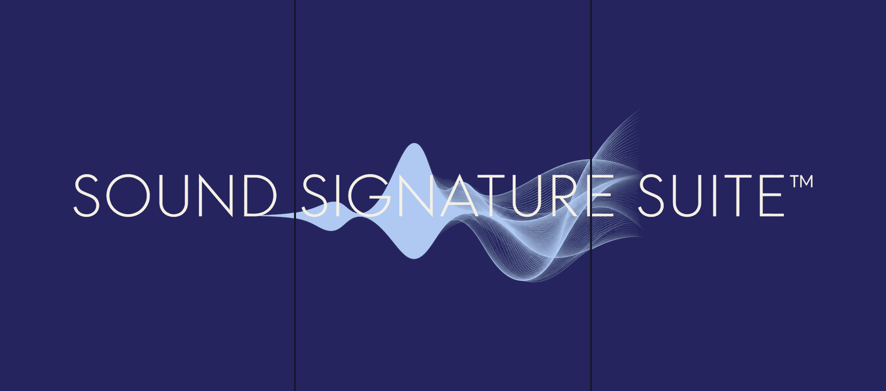

# Sound Signature Suite™

**An audio workspace for DJs, producers and music makers.**

Sound Signature Suite™ brings together music organisation, work with stems, mixing and preparation for export. The project connects the practical and creative sides of working with music, from gathering tracks to shaping a personal result.

BMS™ is part of the suite's audio development, with a focus on processing and mixing musical material.

## Project status

Sound Signature Suite™ is in active development. This repository is its public project showcase, with an introduction and selected visual assets. Software availability and supported configurations will be documented separately as releases are validated.

## Visual identity

The banner uses the original waveform and wordmark in the **F10** palette: deep indigo, pale blue and warm ivory.

## Follow the project

[**@soundsignaturesuite on Instagram**](https://www.instagram.com/soundsignaturesuite/)

For project news, questions or collaboration enquiries, visit the Instagram profile. DJs, producers, educators and creators are welcome.

---

Sound Signature Suite™ · BMS™
